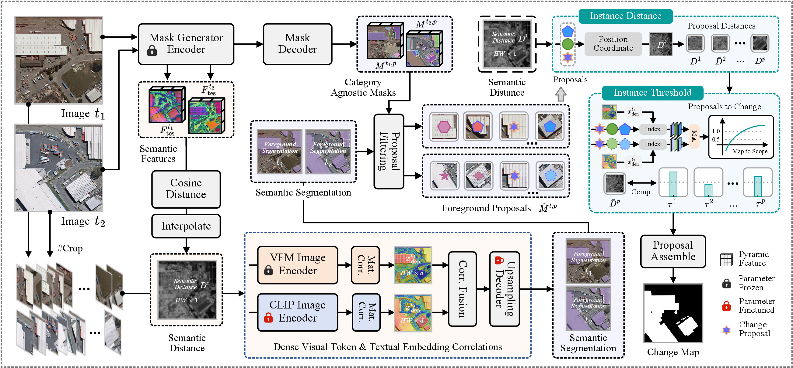

<div align="center">

<h1>Exploring CLIP Dense Semantic Priors for Source-Free Unsupervised Domain Adaptation in Remote Sensing Change Detection</h1>

<div>
    <strong>From target-domain semantic adaptation to change estimation</strong>
</div>

<div>
    <a href='https://github.com/yogurts-sy' target='_blank'>You Su</a><sup>1</sup>&emsp;
    <a href='' target='_blank'>Yonghong Song</a><sup>✉1</sup>&emsp;
    <a href='' target='_blank'>Jiaao Huang</a><sup>1</sup>&emsp;
    <a href='' target='_blank'>Yi Liu</a><sup>1</sup>&emsp;
    <a href='' target='_blank'>Jingtao Chen</a><sup>2</sup>&emsp;
    <a href='' target='_blank'>Jingqi Chen</a><sup>1</sup>&emsp;
    <a href='' target='_blank'>Zehan Wen</a><sup>1</sup>&emsp;
</div>
<div>
    <sup>1</sup>Xi'an Jiaotong University&emsp;
</div>
<div>
    <sup>2</sup>Beijing Jiaxun Feihong Electrical Co., Ltd.&emsp;
</div>

</div>

## Abstract
> Change detection (CD) is a crucial task for analyzing the impacts of anthropogenic and ecological changes on Earth’s land-cover. Although unsupervised CD alleviates the dependence on pixel-level change annotations, existing methods primarily capture change vectors from registered bi-temporal remote sensing images (RSIs) while paying limited attention to target-domain semantic knowledge. Meanwhile, complex and varying geographical environments and imaging conditions can induce semantic shifts in vision foundation models (VFMs) when applied to unseen domains. Moreover, the rich semantic clue contained in RSIs remains underexploited. To address these, we propose UDA-CD, establishing a new paradigm from target-domain semantic adaptation to change estimation. Specifically, we first introduce bi-granularity domain prototype retrieval (BDPR), which jointly exploits global and dense visual semantics to retrieve reliable category prototypes from unlabelled single-temporal images. We then propose Transformer attention block adaptation (TABA), which parameter-efficiently adjusts CLIP attention via matching-cost constraints, adapting its dense visual tokens to target-domain environments and imaging conditions. Finally, we develop knowledge transfer to change detection (KTCD), which leverages the adapted category semantics to extract potential change proposals and combines cross-temporal semantic differences with instance-level adaptive thresholds to distinguish genuine land-cover changes from non-semantic visual disturbances. Experiments on multiple CD benchmarks spanning diverse geographical scenes and imaging conditions demonstrate that UDA-CD achieves superior detection performance without change annotations and exhibits strong cross-scene adaptability.


> Overall framework for target-domain prototype collection and CLIP adaptation. First, high-quality target-domain prototypes are retrieved through bi-granularity semantic classification. Subsequently, the matching costs between CLIP dense visual tokens and semantic categories are constrained to align with the retrieved target-domain prototypes, enabling CLIP to capture target-domain semantics.



> Overall framework for target-domain prototype collection and CLIP adaptation. First, high-quality target-domain prototypes are retrieved through bi-granularity semantic classification. Subsequently, the matching costs between CLIP dense visual tokens and semantic categories are constrained to align with the retrieved target-domain prototypes, enabling CLIP to capture target-domain semantics.

## Main Results
### Unsupervised Binary Change Detection

| Method | **[WHU](http://gpcv.whu.edu.cn/data/building_dataset.html)** |  |  |  | **[LEVIR](https://justchenhao.github.io/LEVIR/)** |  |  |  |
|:------|---:|---:|---:|---:|---:|---:|---:|---:|
| | **F1** | **IoU** | **Rec** | **Pre** | **F1** | **IoU** | **Rec** | **Pre** |
| PCA_KM | 14.33 | 7.72 | 55.05 | 8.24 | 9.96 | 5.24 | 39.50 | 5.70 |
| CVA | 7.17 | 3.72 | 62.03 | 3.81 | 9.27 | 4.86 | 61.27 | 5.01 |
| IRMAD | 16.32 | 8.89 | 21.33 | 13.22 | 14.21 | 7.65 | 18.22 | 11.65 |
| DCVA | 20.55 | 11.45 | 59.96 | 12.40 | 13.85 | 7.44 | 75.50 | 7.63 |
| Inst-CEG | 62.54 | 45.49 | 73.62 | 54.35 | 63.29 | 46.30 | 81.96 | 51.55 |
| AnyChange | 28.13 | 16.37 | **96.16** | 16.48 | 32.68 | 19.53 | 81.06 | 20.46 |
| UCD-SCM | 32.13 | 19.14 | 76.81 | 20.31 | 32.36 | 19.30 | 50.21 | 23.87 |
| BiSAM-CD | 41.26 | 25.99 | *94.88* | 26.36 | 53.79 | 36.79 | **93.35** | 37.78 |
| STU-SAMI | 33.15 | 19.87 | 69.94 | 21.72 | 33.50 | 20.12 | 64.19 | 22.66 |
| DynEarth (MCI) | 57.35 | 40.20 | 63.43 | 52.33 | 46.43 | 30.23 | 73.33 | 33.97 |
| DynEarth (IMC) | *75.85* | *61.09* | 73.96 | *77.84* | *69.70* | *53.50* | 78.09 | *62.94* |
| **UDA-CD (ours)** | **86.16** | **75.68** | 90.75 | **82.01** | **72.65** | **57.05** | 80.62 | **66.12** |

| Method | **[DSIFN](https://github.com/GeoZcx/A-deeply-supervised-image-fusion-network-for-change-detection-in-remote-sensing-images/tree/master/dataset)** |  |  |  | **[CLCD](https://github.com/liumency/CropLand-CD)** |  |  |  |
|:------|---:|---:|---:|---:|---:|---:|---:|---:|
| | **F1** | **IoU** | **Rec** | **Pre** | **F1** | **IoU** | **Rec** | **Pre** |
| PCA_KM | 35.48 | 21.57 | 45.35 | 29.14 | 18.42 | 10.14 | 40.76 | 11.90 |
| CVA | 27.88 | 16.20 | 66.29 | 17.65 | 13.39 | 7.17 | 60.42 | 7.53 |
| IRMAD | 16.76 | 9.15 | 10.67 | 39.09 | 27.99 | 16.27 | 28.70 | 27.32 |
| DCVA | 38.52 | 23.85 | **76.31** | 25.76 | 20.81 | 11.62 | *74.77* | 12.09 |
| Inst-CEG | 31.81 | 18.91 | 22.46 | 54.50 | 6.76 | 3.50 | 5.18 | 9.73 |
| AnyChange | 39.19 | 24.37 | 52.25 | 31.36 | 31.96 | 19.02 | 63.63 | 21.33 |
| UCD-SCM | 40.13 | 25.10 | 51.61 | 32.82 | 23.31 | 13.19 | 32.49 | 18.18 |
| BiSAM-CD | *54.53* | *37.48* | 66.42 | 46.25 | 31.01 | 18.35 | **81.60** | 19.15 |
| STU-SAMI | 43.40 | 27.71 | *69.27* | 31.60 | *37.07* | *22.75* | 63.22 | 26.22 |
| DynEarth (MCI) | 54.35 | 37.32 | 44.44 | *69.96* | 23.83 | 13.52 | 19.47 | 30.70 |
| DynEarth (IMC) | 26.42 | 15.22 | 15.45 | **90.96** | 14.97 | 8.09 | 8.22 | **83.52** |
| **UDA-CD (ours)** | **60.31** | **43.17** | 54.10 | 68.12 | **44.97** | **29.00** | 60.83 | *35.66* |

## Dependencies and Installation

Please follow the version information provided in `requirements.txt`. The installation procedure for the key dependencies is as follows:
```bash
# 1. Python version and Conda environment setup
conda create -n UDA-CD python=3.8.20

# 2. torch, torchvision, torchaudio, xformers
pip install torch==2.3.0 torchvision==0.18.0 torchaudio==2.3.0 --index-url https://download.pytorch.org/whl/cu118

# 3. mmcv
pip install -U openmim
mim install mmcv==2.2.0

# 4. Comment out the mmcv version constraint in mmseg:
# (in /root/miniconda3/envs/UDA-CD/lib/python3.8/site-packages/mmseg/init.py, lines 61–63)

# assert (mmcv_min_version <= mmcv_version < mmcv_max_version), \\
#     f'MMCV=={mmcv.__version__} is used but incompatible. ' \\
#     f'Please install mmcv>=2.0.0rc4.'

# 5. other dependencies
pip install -r requirements.txt
```

## Download Checkpoints
Please download the pretrained weights for SAM, RemoteCLIP and DINO. Please place them in the corresponding directories.

1. Download `sam_vit_h_4b8939.pth` checkpoints from [SAM's repo](https://dl.fbaipublicfiles.com/segment_anything/sam_vit_h_4b8939.pth) and put it into `./pretrained`.
2. Download `RemoteCLIP-ViT-L-14.pt` checkpoints from [HF](https://huggingface.co/chendelong/RemoteCLIP/blob/main/RemoteCLIP-ViT-L-14.pt) and put it into `./pretrained`.
3. Download `RemoteCLIP-ViT-B-32.pt` checkpoints from [HF](https://huggingface.co/chendelong/RemoteCLIP/resolve/main/RemoteCLIP-ViT-B-32.pt) and put it into `./pretrained`.
4. Download `ViT-B-16.pt` checkpoints from [CLIP's repo](https://openaipublic.azureedge.net/clip/models/5806e77cd80f8b59890b7e101eabd078d9fb84e6937f9e85e4ecb61988df416f/ViT-B-16.pt) and put it into `./pretrained`.
5. Download `dino_vitbase8_pretrain.pth` checkpoints from [DINO's repo](https://dl.fbaipublicfiles.com/dino/dino_vitbase8_pretrain/dino_vitbase8_pretrain.pth) and put it into `./pretrained`.
 
## Model Training & Inference
### 1. Domain Prototype Retrieval & Adaptation (Model Training)
```python
# 1. Download the WHU-CD dataset and replace `INPUT_PATHs` in prototype_retri_whu.py
# 2. Download pretrained weights and install dependencies
python prototype_retri_whu.py # e.g., WHU-CD

# 3. Transformer attention block adaptation for CLIP
python taba_ada.py --config-file ./configs/TABA_WHU_ViT_B.yaml
```

### 2. Knowledge Transfer to CD (Model Inference)

```python
# Modify `dataset_root_path` in `test_WHU-CD.sh`
sh ./scripts/test_WHU-CD.sh
```
## Results Reproduce
Download model checkpoints from [WHU-CD/model_0029999.pth](https://github.com/yogurts-sy/Seg2Change/blob/main/exp/CK/best.pth) and put it into `./Output_Ada/Reproduce/`.
```python
# 1. Modify `MODEL.WEIGHTS` in `test_WHU-CD.sh` with our trained weights
# 2. Modify `dataset_root_path` in `test_WHU-CD.sh`
sh ./scripts/test_WHU-CD.sh # e.g., WHU-CD
```

