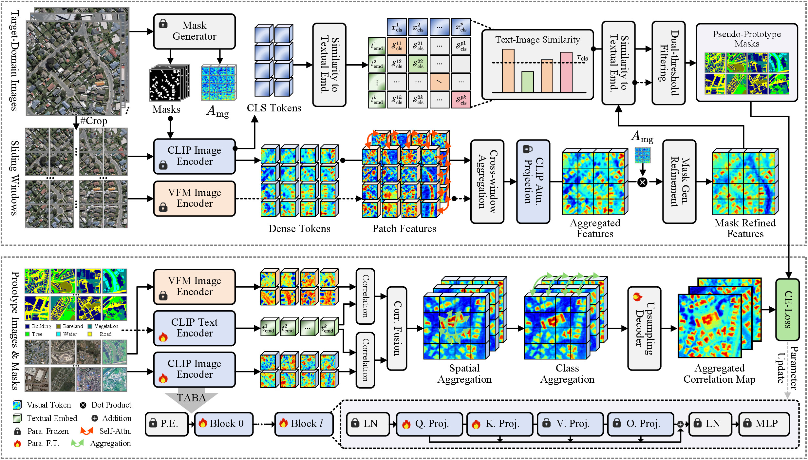

<div align="center">

<h1>ST<sup>2</sup>DPA-CD: Single-Temporal Target-Domain Prototype Adaptation for Remote Sensing Change Detection</h1>

<div>
    <strong>From target-domain semantic adaptation to change estimation</strong>
</div>

<div>
    <a href='https://github.com/yogurts-sy' target='_blank'>You Su</a><sup>1</sup>&emsp;
    <a href='' target='_blank'>Yonghong Song</a><sup>✉1</sup>&emsp;
    <a href='' target='_blank'>Jiaao Huang</a><sup>1</sup>&emsp;
    <a href='' target='_blank'>Yi Liu</a><sup>1</sup>&emsp;
    <a href='' target='_blank'>Xiaoyun Yang</a><sup>2</sup>&emsp;
    <a href='' target='_blank'>Jingqi Chen</a><sup>1</sup>&emsp;
    <a href='' target='_blank'>Zehan Wen</a><sup>1</sup>&emsp;
</div>
<div>
    <sup>1</sup>Xi'an Jiaotong University&emsp;
</div>
<div>
    <sup>2</sup>Beijing Jiaxun Feihong Electrical Co., Ltd.&emsp;
</div>

</div>

## Abstract
> Remote sensing change detection (CD) is a crucial task for analyzing the impacts of ecological changes, yet existing methods often rely on costly annotations or spatially registered training pairs. Although vision foundation models (VFMs) have enabled annotation-free CD, distribution gaps between pre-training and target domains remain a significant challenge. To address this issue, we propose ST$^2$DPA-CD, a single-temporal target-domain prototype adaptation framework that mines semantic knowledge from unlabeled single-temporal images and transfers it to bi-temporal CD. Specifically, bi-granularity domain prototype retrieval (BDPR) integrates global and dense visual representations to construct reliable target-domain category prototypes. Transformer attention block adaptation (TABA) then leverages these prototypes to efficiently adapt VFM through parameter-efficient fine-tuning. Further, an instance-specific threshold (IST) strategy transfers the adapted semantic knowledge to CD through adaptive change estimation, suppressing spurious detections. Extensive experiments on four benchmark datasets demonstrate that ST$^2$DPA-CD achieves state-of-the-art performance in annotation-free CD. Additional experiments further validate its effectiveness in semi-supervised learning and cross-domain generalization.



> Overall framework for target-domain prototype collection and CLIP adaptation. First, high-quality target-domain prototypes are retrieved through bi-granularity semantic classification. Subsequently, the correlation maps between CLIP dense visual tokens and semantic categories are constrained to align with the retrieved target-domain prototypes, enabling CLIP to capture target-domain semantics.


> Overview of the proposed IST for change detection. Foreground change proposals are identified using category-agnostic masks and the adapted CLIP, while bi-temporal feature dissimilarities are computed from the mask generator features. An instance-specific threshold is then estimated for each proposal by jointly considering semantic similarity and feature dissimilarity. Finally, proposals exceeding their adaptive thresholds are merged to generate the binary change map.

## Main Results
### Annotation-Free Change Detection

| Method | Base Model | **[WHU](http://gpcv.whu.edu.cn/data/building_dataset.html)** | | | | **[LEVIR](https://justchenhao.github.io/LEVIR/)** | | | |
|:------|:------|---:|---:|---:|---:|---:|---:|---:|---:|
| | | **F1** | **IoU** | **Rec.** | **Pre.** | **F1** | **IoU** | **Rec.** | **Pre.** |
| DCVA | / | 20.55 | 11.45 | 59.96 | 12.40 | 13.85 | 7.44 | 75.50 | 7.63 |
| Inst-CEG | APE | 62.54 | 45.49 | 73.62 | 54.35 | 63.29 | 46.30 | <u>81.96</u> | 51.55 |
| AnyChange | SAM | 28.13 | 16.37 | **96.16** | 16.48 | 32.68 | 19.53 | 81.06 | 20.46 |
| UCD-SCM | FastSAM | 32.13 | 19.14 | 76.81 | 20.31 | 32.36 | 19.30 | 50.21 | 23.87 |
| BiSAM-CD | SAM2 | 41.26 | 25.99 | <u>94.88</u> | 26.36 | 53.79 | 36.79 | **93.35** | 37.78 |
| STU-SAMI | SAM | 33.15 | 19.87 | 69.94 | 21.72 | 33.50 | 20.12 | 64.19 | 22.66 |
| AdaptOVCD | DGTRS-CLIP | 76.53 | 61.99 | 72.85 | 80.60 | 68.00 | 51.52 | 74.10 | 62.83 |
| OpenDPR | APE | 79.15 | 65.50 | 75.41 | <u>83.28</u> | 61.90 | 44.82 | 74.74 | 52.83 |
| UniVCD (SAM2) | SAM2 | 76.50 | 61.90 | 84.10 | 70.20 | 70.70 | 54.70 | 77.90 | 64.70 |
| UniVCD (SAM3) | SAM3 | <u>79.50</u> | <u>66.00</u> | 73.30 | **86.80** | <u>72.30</u> | <u>56.70</u> | 65.10 | **81.40** |
| DynamEarth (MCI) | SegEarth-OV | 57.35 | 40.20 | 63.43 | 52.33 | 46.43 | 30.23 | 73.33 | 33.97 |
| DynamEarth (IMC) | APE | 75.85 | 61.09 | 73.96 | 77.84 | 69.70 | 53.50 | 78.09 | 62.94 |
| UCD-SCM† | RCLIP | 68.31 | 51.87 | 87.45 | 56.04 | 66.14 | 49.41 | 64.44 | <u>67.93</u> |
| AdaptOVCD† | RCLIP | 76.97 | 62.56 | 88.63 | 68.02 | 65.61 | 48.82 | 69.45 | 62.18 |
| **ST²DPA-CD (ours)** | RCLIP | **86.16** | **75.68** | 90.75 | 82.01 | **72.65** | **57.05** | 80.62 | 66.12 |

**Note:** Bold and underlined values indicate the best and second-best results, respectively. † denotes variants re-implemented using RemoteCLIP (RCLIP). All metrics are expressed as percentages (%).


| Method | Base Model | **[DSIFN](https://github.com/GeoZcx/A-deeply-supervised-image-fusion-network-for-change-detection-in-remote-sensing-images/tree/master/dataset)** | | | | **[CLCD](https://github.com/liumency/CropLand-CD)** | | | |
|:------|:------|---:|---:|---:|---:|---:|---:|---:|---:|
| | | **F1** | **IoU** | **Rec.** | **Pre.** | **F1** | **IoU** | **Rec.** | **Pre.** |
| DCVA | / | 38.52 | 23.85 | **76.31** | 25.76 | 20.81 | 11.62 | <u>74.77</u> | 12.09 |
| Inst-CEG | APE | 31.81 | 18.91 | 22.46 | 54.50 | 6.76 | 3.50 | 5.18 | 9.73 |
| AnyChange | SAM | 39.19 | 24.37 | 52.25 | 31.36 | 31.96 | 19.02 | 63.63 | 21.33 |
| UCD-SCM | FastSAM | 40.13 | 25.10 | 51.61 | 32.82 | 23.31 | 13.19 | 32.49 | 18.18 |
| BiSAM-CD | SAM2 | 54.53 | 37.48 | 66.42 | 46.25 | 31.01 | 18.35 | **81.60** | 19.15 |
| STU-SAMI | SAM | 43.40 | 27.71 | 69.27 | 31.60 | 37.07 | 22.75 | 63.22 | 26.22 |
| AdaptOVCD | DGTRS-CLIP | 59.47 | 42.32 | 64.42 | 55.23 | 38.97 | 24.20 | 50.81 | 31.61 |
| OpenDPR | APE | 46.16 | 30.00 | 67.98 | 34.94 | <u>42.91</u> | <u>27.31</u> | 61.29 | 33.01 |
| DynamEarth (MCI) | SegEarth-OV | 54.35 | 37.32 | 44.44 | <u>69.96</u> | 23.83 | 13.52 | 19.47 | 30.70 |
| DynamEarth (IMC) | APE | 26.42 | 15.22 | 15.45 | **90.96** | 14.97 | 8.09 | 8.22 | **83.52** |
| UCD-SCM† | RCLIP | 46.96 | 30.69 | 41.38 | 54.29 | 37.94 | 23.41 | 66.18 | 26.60 |
| AdaptOVCD† | RCLIP | <u>59.85</u> | <u>42.71</u> | <u>71.66</u> | 51.39 | 41.14 | 25.90 | 48.00 | <u>36.00</u> |
| **ST²DPA-CD (ours)** | RCLIP | **60.31** | **43.17** | 54.10 | 68.12 | **44.97** | **29.00** | 60.83 | 35.66 |

**Note:** Bold and underlined values indicate the best and second-best results, respectively. † denotes variants re-implemented using RemoteCLIP (RCLIP). All metrics are expressed as percentages (%).

## Dependencies and Installation

Please follow the version information provided in `requirements.txt`. The installation procedure for the key dependencies is as follows:
```bash
# 1. Python version and Conda environment setup
conda create -n ST2DPA-CD python=3.8.20
conda activate ST2DPA-CD

# 2. Install torch, torchvision, torchaudio
pip install torch==2.3.0 torchvision==0.18.0 torchaudio==2.3.0 --index-url https://download.pytorch.org/whl/cu118

# 3. mmcv
pip install -U openmim
mim install mmcv==2.2.0

# 4. Comment out the mmcv version constraint in mmseg:
# (in /root/miniconda3/envs/ST2DPA-CD/lib/python3.8/site-packages/mmseg/init.py, lines 61–63)

# assert (mmcv_min_version <= mmcv_version < mmcv_max_version), \\
#     f'MMCV=={mmcv.__version__} is used but incompatible. ' \\
#     f'Please install mmcv>=2.0.0rc4.'

# 5. Other dependencies
pip install -r requirements.txt

# 6. detectron2
unzip detectron2.zip
cd detectron2
pip install .
```

## Download Checkpoints & Datasets
Please download the pretrained weights for SAM, RemoteCLIP and DINO. Please place them in the corresponding directories.

1. Download `sam_vit_h_4b8939.pth` checkpoints from [SAM's repo](https://dl.fbaipublicfiles.com/segment_anything/sam_vit_h_4b8939.pth) and put it into `./pretrained/`.
2. Download `RemoteCLIP-ViT-L-14.pt` checkpoints from [HF](https://huggingface.co/chendelong/RemoteCLIP/blob/main/RemoteCLIP-ViT-L-14.pt) and put it into `./pretrained/`.
3. Download `dino_vitbase8_pretrain.pth` checkpoints from [DINO's repo](https://dl.fbaipublicfiles.com/dino/dino_vitbase8_pretrain/dino_vitbase8_pretrain.pth) and put it into `./pretrained/`.

We include the following dataset configurations in this repo: 
1) `Building Change Detection`: [WHU-CD](http://gpcv.whu.edu.cn/data/building_dataset.html), [LEVIR-CD](https://justchenhao.github.io/LEVIR/)
2) `Land-Cover Change Detection`: [DSIFN](https://github.com/GeoZcx/A-deeply-supervised-image-fusion-network-for-change-detection-in-remote-sensing-images/tree/master/dataset), [CLCD](https://github.com/liumency/CropLand-CD)

Please download the datasets for preparation. We also provide processed evaluation datasets, in [UCD_Benchmark](https://pan.baidu.com/s/1fPuy18vvezy92C0yyGxCrw?pwd=d73k).

## Model Training & Inference
### 1. Domain Prototype Retrieval & Adaptation (Model Training)
```python
# 1. Download the WHU-CD dataset and replace `INPUT_PATHs` in prototype_retri_whu.py
# 2. Download pretrained weights and install dependencies
python prototype_retri_whu.py # e.g., WHU-CD

# 3. Transformer attention block adaptation for CLIP
python taba_ada.py --config-file ./configs/TABA_WHU_ViT_B.yaml
```

### 2. Knowledge Transfer to CD (Model Inference)

```python
# 1. Modify `dataset_root_path` in `test_WHU-CD.sh`
sh ./scripts/test_WHU-CD.sh
```
## Results Reproduce
We also provide trained weights for all four datasets for reproducing the results. Taking `WHU-CD` as an example, download trained model weights from [checkpoints](https://pan.baidu.com/s/1nuvndmU8SuxAe0wierdviQ?pwd=7ttv) and put it into `./Output_Ada/WHU-CD/`.
```python
# 1. Modify `MODEL.WEIGHTS` in `test_WHU-CD.sh` with our trained weights
# 2. Modify `dataset_root_path` in `test_WHU-CD.sh`
sh ./scripts/test_WHU-CD.sh # reproduce WHU-CD results
```

